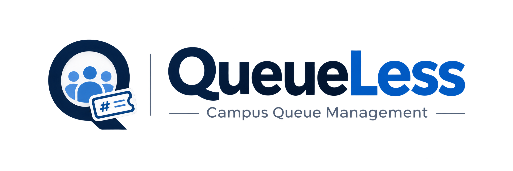

 <p align="center">
  
</p>

<h1 align="center">QueueLess — Smart Campus Queue Management System</h1>

<p align="center">
  A secure, modern campus queue management system connecting students, staff, and university administration.
</p>

---

## 1. Project Overview

QueueLess is a secure, web-based campus queue management system designed to reduce waiting times, improve counter operations, and make university administrative services easier to access.

QueueLess allows students to join service queues and monitor their tickets, staff members to manage their assigned counters, and administrators to monitor campus queue activity and manage staff accounts.


## 2. Main Features

### Student Portal
- Student registration and login.
- Personalized student dashboard.
- View available campus services.
- Check whether services are open or closed.
- Join an available service queue.
- Receive a sequential ticket number.
- View current ticket status and queue position.
- Cancel a ticket while it is waiting.
- View recent ticket history.
- Update profile name and password.

### Staff Portal
- Secure staff login.
- Staff dashboard showing the assigned service.
- View the currently serving ticket.
- View students waiting in the assigned queue.
- Call the next waiting student.
- Complete the currently serving ticket.
- Skip the currently serving ticket.
- View recent queue activity.

Each service is assigned to one staff member in the current implementation.

### Admin Portal
- Secure administrator login.
- Monitor campus services and queue activity.
- View registered students and staff assignments.
- Create staff accounts.
- Assign staff members to services.
- Generate secure, time-limited staff account setup links.

The system is designed with one administrator account. Public registration is restricted to students.

## 3. Queue Management Workflow

1. A student logs in and selects an available campus service.
2. The system checks whether the student already has an active ticket.
3. The system generates the next sequential token number.
4. The ticket is added to the waiting queue.
5. Assigned staff call the next waiting student.
6. The ticket changes to the serving state.
7. Staff complete or skip the currently serving ticket.
8. Students can monitor their ticket status and cancel tickets that are still waiting.

Queue operations use database transactions and row-level locking to help prevent conflicting queue updates and duplicate token allocation.

### Ticket Statuses

| Status | Meaning |
|---|---|
| `waiting` | Student is waiting for their turn. |
| `serving` | Staff has called the student. |
| `completed` | Service has been completed. |
| `skipped` | The currently serving ticket was skipped. |
| `cancelled` | Student cancelled the waiting ticket. |
| `served` | Legacy-compatible database status. |

## 4. Technology Stack

| Component | Technology |
|---|---|
| Backend | PHP 8.x |
| Database | MySQL 8.x |
| Database access | PHP PDO |
| Web server | Apache 2.4 |
| Frontend | HTML5 |
| Styling | CSS3 |
| Client-side scripting | Vanilla JavaScript |
| Development environment | Ubuntu Linux / VirtualBox |
| Code editor | Visual Studio Code |
| Version control | Git and GitHub |

### Development Principles
- No PHP framework required.
- No React or Vue frontend framework.
- No Composer or NPM dependency required by the application.
- PDO prepared statements for database operations.
- Reusable PHP components.
- Responsive Premium Tech-inspired interface.
- Locally stored frontend assets.

## 5. Project Directory Structure

```text
QueueLess/
│
├── index.php
├── login.php
├── register.php
├── logout.php
├── home.php
├── join_queue.php
├── cancel_ticket.php
│
├── admin/
│   ├── index.php
│   └── staff.php
│
├── staff/
│   ├── index.php
│   ├── setup.php
│   └── queue_action.php
│
├── config/
│   ├── database.php
│   └── database.local.php.example
│
├── includes/
│   ├── auth.php
│   ├── csrf.php
│   ├── functions.php
│   ├── header.php
│   └── footer.php
│
├── assets/
│   ├── css/
│   │   └── style.css
│   ├── js/
│   │   └── script.js
│   └── images/
│       └── logo.png
│
├── database/
│   ├── schema.sql
│   └── seed.sql
│
├── docs/
│   ├── DATABASE_DESIGN.md
│   ├── SETUP_UBUNTU.md
│   └── TESTING.md
│
├── README.md
└── .gitignore
```

## 6. Database Design


QueueLess uses MySQL with InnoDB and UTF-8 support.

| Table | Purpose |
|---|---|
| `users` | Stores student, staff, and administrator accounts. |
| `services` | Stores campus services, assigned staff, and availability. |
| `queue_tickets` | Stores tickets, token numbers, statuses, and timestamps. |
| `staff_setup_tokens` | Stores hashed, time-limited staff setup tokens. |

For the database structure and ER diagram, see [`docs/DATABASE_DESIGN.md`](docs/DATABASE_DESIGN.md).

**Important:** `database/schema.sql` is intended for initial database creation. Do not import it over an existing database containing project data without first reviewing the schema and backing up the database.

## 7. Installation and Setup — Ubuntu VirtualBox

For the complete guide, see [`docs/SETUP_UBUNTU.md`](docs/SETUP_UBUNTU.md).

### Requirements
- Ubuntu Linux
- Apache 2.4
- PHP 8.x
- PHP PDO and PDO MySQL extensions
- MySQL 8.x
- Web browser

### Step 1 — Install Required Packages

```bash
sudo apt update
sudo apt install apache2 mysql-server php libapache2-mod-php php-mysql
```

### Step 2 — Configure the Database

For a fresh installation only:

```bash
sudo mysql
```

```sql
CREATE DATABASE queueless_db
CHARACTER SET utf8mb4
COLLATE utf8mb4_unicode_ci;
```

Import the initial schema and sample services:

```bash
sudo mysql queueless_db < /var/www/html/queueless/database/schema.sql
sudo mysql queueless_db < /var/www/html/queueless/database/seed.sql
```

Do not repeat these imports on an existing database without checking the schema and taking a backup.

### Step 3 — Configure Database Credentials

The preferred production configuration is:

```text
/etc/queueless/database.php
```

Create the protected configuration directory:

```bash
sudo mkdir -p /etc/queueless
```

Copy and configure the example:

```bash
sudo cp /var/www/html/queueless/config/database.local.php.example \
/etc/queueless/database.php

sudo nano /etc/queueless/database.php
```

Set ownership and permissions:

```bash
sudo chown www-data:www-data /etc/queueless/database.php
sudo chmod 600 /etc/queueless/database.php
```

The local development configuration `config/database.local.php` must remain private and must never be committed to GitHub.

### Step 4 — Start Services

```bash
sudo systemctl start apache2
sudo systemctl start mysql
```

Open:

```text
http://localhost/queueless/
```

## 8. Account Setup and User Roles

### Student
Students can register using the public registration page. Public registration creates student accounts only.

### Administrator
The application is designed for one administrator account. It must be provisioned securely rather than through public student registration.

### Staff
Administrators create staff accounts and assign staff members to services. Staff receive a secure setup link to create their passwords.

Staff setup links use randomly generated tokens, store token hashes, expire after a limited period, and can only be used once.

## 9. Security Features

1. **Password Hashing:** Uses PHP `password_hash()` and `password_verify()`.
2. **Prepared Statements:** Uses PDO prepared statements for database queries involving user input.
3. **Session Security:** Regenerates session IDs after successful authentication.
4. **Protected Cookies:** Uses HTTP-only and SameSite cookie settings.
5. **CSRF Protection:** Validates tokens on state-changing requests.
6. **Role-Based Access:** Protects student, staff, and administrator routes.
7. **XSS Prevention:** Escapes dynamic output using HTML-safe helpers.
8. **Private Credentials:** Excludes local database credentials from version control.
9. **Secure Staff Setup:** Uses hashed, expiring, one-time setup tokens.
10. **Transactional Queue Operations:** Uses database transactions and row-level locking.

## 10. Testing

See [`docs/TESTING.md`](docs/TESTING.md).

Run PHP syntax checks:

```bash
find . -type f -name "*.php" \
-not -path "./vendor/*" \
-exec php -l {} \;
```

### Important Manual Tests

| Test | Expected Result |
|---|---|
| Student registration | Student account is created. |
| Student login | Student dashboard opens. |
| Join queue | Sequential ticket is generated. |
| Duplicate active ticket | Second active ticket is prevented. |
| Cancel waiting ticket | Ticket changes to cancelled. |
| Staff login | Staff dashboard opens. |
| Call next student | Next waiting ticket becomes serving. |
| Complete ticket | Serving ticket is completed. |
| Skip ticket | Serving ticket is skipped. |
| Admin login | Administrator dashboard opens. |
| Create staff | Staff account and setup link are generated. |
| Assign staff | Selected service is assigned. |
| Unauthorized access | Restricted pages deny access. |

## 11. Current Project Scope

The current implementation includes:
- Student authentication and dashboard.
- Student queue joining and cancellation.
- Staff account creation and password setup.
- Service-based staff assignment.
- Staff queue management.
- Administrator monitoring and staff management.
- Secure PHP/MySQL backend.
- Responsive frontend interface.

Current design decisions:
- One administrator account.
- One staff member assigned per service.
- Staff manage queues for their assigned services.
- Public registration is restricted to students.

## 12. Future Enhancements

Potential improvements include:
- Automatic live queue refresh.
- Real-time student notifications.
- Multiple staff members assigned to a single service.
- Estimated waiting-time calculations.
- Queue analytics and reporting.
- Additional accessibility improvements.

These are future enhancements, not claims about currently implemented functionality.

## 13. GitHub Repository

[QueueLess — GitHub Repository](https://github.com/codebyzaini/QueueLess)

Local database credentials, environment secrets, and database backup files are excluded from version control.

## 14. Academic Project Summary

QueueLess demonstrates:
- PHP server-side development.
- MySQL relational database design.
- Role-based authentication and authorization.
- Secure session management.
- CSRF protection and input validation.
- Database transactions and concurrency handling.
- Responsive frontend development.
- Practical software engineering and documentation.

**Project:** QueueLess — Smart Campus Queue Management System  
**Backend:** PHP  
**Database:** MySQL  
**Frontend:** HTML, CSS, JavaScript  
**Environment:** Ubuntu Linux / VirtualBox  
**Version Control:** Git / GitHub
