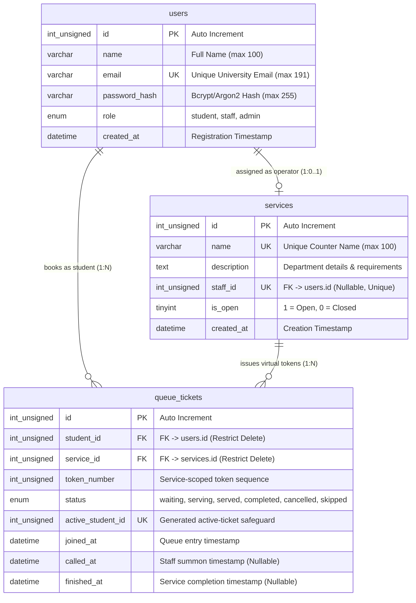

# QueueLess — Database Architecture & ER Design

## 1. System Overview & Architectural Objectives

The database for **QueueLess — Smart Campus Queue Management System** is architected to support university service operations with high transactional integrity, historical audit preservation, and zero data leakage.

### Engineering Decisions & Standards
- **Database Engine:** MySQL 8.x InnoDB (ACID compliant, foreign key enforcement, row-level locking).
- **Character Set & Collation:** `utf8mb4` with `utf8mb4_unicode_ci` (full multilingual support, standard modern Unicode).
- **Audit Preservation:** Restrictive deletion constraints (`ON DELETE RESTRICT`) prevent destructive cascading deletes on historic ticket records.
- **Strict Role Boundaries:** Role elevations are strictly forbidden at both application and data access layers.

---

## 2. Entity-Relationship (ER) Diagram

The diagram below reflects the authoritative schema in `database/schema.sql`:



---

## 3. Data Dictionary: Tables, Attributes & Constraints

### 3.1. Table: `users`
Represents all system actors across student, administrative, and staff tiers.

| Attribute | Data Type | Nullable | Default | Constraints | Description |
| :--- | :--- | :--- | :--- | :--- | :--- |
| `id` | `INT UNSIGNED` | NO | AUTO_INCREMENT | `PRIMARY KEY` | Unique synthetic identifier for the user. |
| `name` | `VARCHAR(100)` | NO | None | None | Student or employee legal full name. |
| `email` | `VARCHAR(191)` | NO | None | `UNIQUE KEY uq_users_email` | University login email; indexed for fast authentication. |
| `password_hash` | `VARCHAR(255)` | NO | None | None | Password hash produced by PHP's `password_hash()`. |
| `role` | `ENUM('student','staff','admin')` | NO | `'student'` | None | Access role. Public registration only creates `'student'`. |
| `created_at` | `DATETIME` | NO | `CURRENT_TIMESTAMP` | None | Account creation timestamp. |

---

### 3.2. Table: `services`
Represents physical campus counters and departmental consultation points (e.g., Registrar, Financial Aid).

| Attribute | Data Type | Nullable | Default | Constraints | Description |
| :--- | :--- | :--- | :--- | :--- | :--- |
| `id` | `INT UNSIGNED` | NO | AUTO_INCREMENT | `PRIMARY KEY` | Unique synthetic identifier for the service. |
| `name` | `VARCHAR(100)` | NO | None | `UNIQUE KEY uq_services_name` | Department or desk title (e.g., "Registrar's Office"). |
| `description` | `TEXT` | YES | `NULL` | None | Service scope, documents to bring, and office hours. |
| `staff_id` | `INT UNSIGNED` | YES | `NULL` | `UNIQUE KEY uq_services_staff_id`, `FK -> users(id)` | Assigned staff operator. Enforces 1:1 assignment. |
| `is_open` | `TINYINT(1)` | NO | `1` | None | Counter status: `1` accepts tickets, `0` paused/closed. |
| `created_at` | `DATETIME` | NO | `CURRENT_TIMESTAMP` | None | Record creation timestamp. |

#### Foreign Key Policy: `fk_services_staff`
- `ON DELETE SET NULL`: If a staff employee leaves or their user account is deactivated, the service counter and its historic queue data remain intact. The `staff_id` simply becomes `NULL` until reassigned.
- `ON UPDATE CASCADE`: If a user ID changes, the reference propagates automatically.

---

### 3.3. Table: `queue_tickets`
Tracks student queue positions, lifecycle timestamps, and counter interactions.

| Attribute | Data Type | Nullable | Default | Constraints | Description |
| :--- | :--- | :--- | :--- | :--- | :--- |
| `id` | `INT UNSIGNED` | NO | AUTO_INCREMENT | `PRIMARY KEY` | Unique synthetic identifier for each ticket instance. |
| `student_id` | `INT UNSIGNED` | NO | None | `FK -> users(id)` | Foreign key referencing the student who queued. |
| `service_id` | `INT UNSIGNED` | NO | None | `FK -> services(id)` | Foreign key referencing the target campus service. |
| `token_number` | `INT UNSIGNED` | NO | None | Part of `uq_service_token` | Sequential identifier within that department (e.g. 101). |
| `status` | `ENUM('waiting','serving','served','completed','cancelled','skipped')` | NO | `'waiting'` | None | Current ticket lifecycle status. |
| `active_student_id` | `INT UNSIGNED GENERATED ALWAYS AS (...) STORED` | YES | Generated | `UNIQUE KEY uq_active_ticket_per_student` | Non-NULL only for `waiting` or `serving` tickets; final database safeguard for one active ticket per student. |
| `joined_at` | `DATETIME` | NO | `CURRENT_TIMESTAMP` | None | Exact timestamp the virtual token was issued. |
| `called_at` | `DATETIME` | YES | `NULL` | None | Timestamp when counter operator summoned the student. |
| `finished_at` | `DATETIME` | YES | `NULL` | None | Timestamp when interaction concluded. |

#### Composite Constraint: `uq_service_token`
- `UNIQUE KEY uq_service_token (service_id, token_number)`
- **Purpose:** Guarantees that within a given service, no two tickets can ever share the same token number.

#### Generated Unique Constraint: `uq_active_ticket_per_student`
- `active_student_id` is generated as `student_id` only when `status IN ('waiting','serving')`; otherwise it is `NULL`.
- MySQL unique keys allow multiple `NULL` values, so historic terminal tickets remain unlimited.
- **Purpose:** Provides a database-level final safeguard against concurrent duplicate active tickets for the same student.

#### Foreign Key Deletion Policy:
- `fk_tickets_student`: `ON DELETE RESTRICT`
- `fk_tickets_service`: `ON DELETE RESTRICT`
- **Purpose:** University compliance and auditing require that student attendance records and service history cannot be silently deleted if someone tries to delete a user or service record. Deleting parent records is blocked until tickets are archived according to university policy.

#### Indexes for Query Optimization:
- `idx_tickets_student_status (student_id, status)`: Accelerates queries when a student loads their dashboard to check their active tickets.
- `idx_tickets_service_status (service_id, status)`: Accelerates queries when staff operators fetch the next waiting student (`status = 'waiting'`).

---

## 4. Relationship Cardinality Analysis

1. **`users` (staff) to `services` (1:0..1 — One-to-One, Optional):**
   - Each service has at most one assigned staff operator (`staff_id` has a `UNIQUE` constraint).
   - A staff user can manage at most one service counter.
   - If unassigned, `staff_id` is `NULL`.
   - *Application Workflow Requirement:* Before assigning a `staff_id`, the administrative application must verify that `users.role = 'staff'`.

2. **`users` (student) to `queue_tickets` (1:N — One-to-Many):**
   - A single student can request virtual tickets across different days and departments.
   - Each ticket belongs strictly to exactly one student (`student_id NOT NULL`).

3. **`services` to `queue_tickets` (1:N — One-to-Many):**
   - A single campus service issues numerous tickets over its operational lifetime.
   - Each ticket is issued by exactly one service counter (`service_id NOT NULL`).

---

## 5. Critical Database Design Rules Explained for Teachers

### Question A: "Why can't we use a simple UNIQUE constraint to prevent a student from holding multiple active tickets?"

**Common Student Mistake:** Adding a unique constraint such as `UNIQUE (student_id, status)`.

**Why this fails in practice:**
1. A student frequently returns to campus offices on subsequent days. Once a ticket reaches a terminal status (`'served'`, `'completed'`, or `'cancelled'`), the student accumulates multiple terminal records over their academic career.
2. If `(student_id, status)` was constrained to be unique, after the student's *first* visit was completed, they could **never** complete another ticket at any counter, because inserting a second `'completed'` row would violate the constraint!
3. Multiple statuses constitute an active ticket (both `'waiting'` and `'serving'`).
4. MySQL (through 8.4) does not support partial or conditional unique indexes (such as PostgreSQL's `WHERE status IN ('waiting', 'serving')`).

**The Authoritative Solution (System-Wide Single Active Ticket Policy):**
A student may hold at most ONE active ticket across all university services at any time. This prevents "ghost queueing" (students holding slots in multiple departments simultaneously and causing no-shows when two counters call them at the same time).
Enforced in both the application layer and the database:

1. The join transaction locks the authenticated student's `users` row before checking active tickets. This closes the empty-row race where two first-ticket requests could both observe no active row.
2. The generated `active_student_id` column and `uq_active_ticket_per_student` unique key provide a final MySQL constraint-level safeguard.

```sql
START TRANSACTION;

-- Serialize all join attempts for this student, even when no active ticket exists yet.
SELECT id
FROM users
WHERE id = ? AND role = 'student'
FOR UPDATE;

-- Check if student already holds an active token anywhere across the university
SELECT id, service_id 
FROM queue_tickets 
WHERE student_id = ? 
  AND status IN ('waiting', 'serving')
FOR UPDATE;

-- If active ticket exists: ROLLBACK and return clear policy notice to student.
-- If no active ticket exists: proceed with token issuance.
-- The INSERT is also protected by uq_active_ticket_per_student.
```

---

### Question B: "How do we allocate token numbers safely when multiple students click 'Join Queue' simultaneously?"

**Naive approach that fails under load:**
```sql
-- DANGEROUS: Susceptible to race conditions!
SELECT MAX(token_number) + 1 FROM queue_tickets WHERE service_id = 1;
-- If two requests execute this at the exact same millisecond, both get 105.
-- One crashes with a duplicate key violation against uq_service_token!
```

**The Robust Solution (Pessimistic Row-Locking on Service Counter):**
```sql
START TRANSACTION;

-- Step 1: Lock the service counter row exclusively
SELECT id FROM services WHERE id = ? FOR UPDATE;

-- Step 2: Calculate the next sequential token number for this service safely
SELECT COALESCE(MAX(token_number), 0) + 1 INTO @next_token 
FROM queue_tickets 
WHERE service_id = ?;

-- Step 3: Insert the ticket record
INSERT INTO queue_tickets (student_id, service_id, token_number, status, joined_at)
VALUES (?, ?, @next_token, 'waiting', NOW());

COMMIT;
```
Because `SELECT ... FOR UPDATE` acquires an exclusive row lock on the service record, all concurrent queue join requests for that specific service counter are serialized cleanly. No duplicate token collisions can occur.

---

## 6. Summary Presentation Cheat Sheet (For Teacher Defense)

When explaining this design to your instructor, highlight these four key points:
1. **Third Normal Form (3NF):** Every non-key attribute depends solely on the primary key, eliminating data duplication and update anomalies.
2. **Defensive Deletion Policies:** We use `ON DELETE RESTRICT` for tickets so student historical records and department audits cannot be destroyed by an accidental user deletion.
3. **Pessimistic Concurrency Control:** Token generation is designed with `SELECT ... FOR UPDATE` row locks to guarantee thread safety during peak campus enrollment periods.
4. **Separation of Concerns:** Static structural constraints are managed by MySQL (unique emails, valid FKs, token uniqueness, and active ticket uniqueness), while workflow checks such as staff role verification are maintained by the PHP application layer.
